# Mô hình hóa biến động ngẫu nhiên của cổ phiếu Vingroup (VIC) bằng Monte Carlo

> Đề tài môn Mô Phỏng Toán. Bài tập học thuật, **không phải khuyến nghị đầu tư**.

---

## Giới thiệu: bài toán – mô hình – dữ liệu – đầu ra

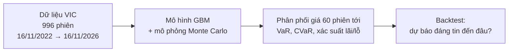

| | Nội dung |
|---|---|
| **Vấn đề** | Giá VIC biến động ngẫu nhiên. Với **một quỹ đạo lịch sử duy nhất**, làm sao nói được giá 60 phiên tới *có thể* nằm ở đâu, rủi ro bao nhiêu, và **phát biểu đó đáng tin đến mức nào**? |
| **Mô hình** | Chuyển động Brown hình học (GBM) cho quá trình giá, mô phỏng bằng Monte Carlo |
| **Dữ liệu** | **996 phiên** giao dịch ngày của VIC (HOSE). Thu thập từ **16/11/2022**, ngày cuối cùng thu thập **16/11/2026**. Nguồn Investing.com, giá tính bằng VND |
| **Sẽ làm gì** | Làm sạch dữ liệu → ước lượng μ, σ → kiểm định giả thiết → mô phỏng 10.000 quỹ đạo → tính rủi ro → backtest cuốn chiếu |
| **Đầu ra mong muốn** | (1) dải giá 90% và 50% sau 60 phiên; (2) VaR, CVaR, xác suất lãi/lỗ; (3) mức nhạy của dự báo với giả định xu hướng μ; (4) **độ phủ backtest xấp xỉ 90%**, nếu đạt thì dải dự báo đáng tin, nếu không thì đo được mô hình sai ở đâu; (5) kết luận mô hình dùng được vào việc gì |

---

## 1. Phát biểu bài toán

### 1.1 Dữ liệu VIC cho ta biết gì

| Câu hỏi về dữ liệu thực | Trả lời từ dữ liệu |
|---|---|
| Giá đã đi đâu? | 30.200 → 247.800 VND, tăng **8,21 lần** (thấp nhất 19.950, cao nhất 256.100) |
| Xu hướng có ổn định không? | **Không.** μ̂ trên cửa sổ 250 phiên đi từ **−57% đến +231%**/năm |
| Mức rủi ro có ổn định không? | **Không.** σ̂ đi từ **19% đến 56%**/năm; biến động 20/60/120 phiên gần nhất (33%/36%/39%) thấp hơn σ̂ của 250 phiên (50%) |
| Các cú sốc có độc lập không? | **Không.** Ljung–Box trên r²: p = 0,0006 → có **cụm biến động** |
| Log-return có chuẩn không? | Trong 250 phiên gần nhất chưa bác bỏ được (Jarque–Bera p = 0,30; độ nhọn dư 0,39) |
| Giá có bị chặn biên độ không? | Có: **49/995 phiên** chạm trần/sàn ±7% (31 trần, 18 sàn). Nếu log-return chuẩn thì chỉ kỳ vọng khoảng 6,5 phiên (gợi ý, vì σ toàn kỳ trộn nhiều chế độ) |
| Giá có đi liên tục không? | 109 phiên (11%) giá đứng yên |
| Dữ liệu có sạch không? | Sạch: 996/996 dòng hợp lệ, không trùng ngày, giá Mở/Cao/Thấp/Đóng nhất quán, cột "% Thay đổi" khớp giá tự tính. 13 khoảng trống > 4 ngày là nghỉ lễ/Tết |

### 1.2 Tư duy tiền xử lý dữ liệu

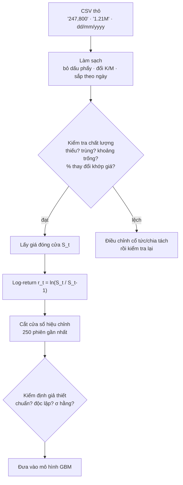

| Quyết định | Lý do |
|---|---|
| Chỉ dùng **giá đóng cửa** | Mô hình một biến; giá đóng cửa là giá chốt của phiên, ít nhiễu hơn giá trong phiên |
| Dùng **log-return**, không dùng giá | Cộng được theo thời gian, đảm bảo giá luôn dương, và GBM nói log-return có phân phối chuẩn |
| Cửa sổ **250 phiên** (~1 năm) | Đủ dữ liệu để ước lượng σ, đủ ngắn để bám chế độ gần đây. Đổi bằng `--calib-days` |
| Kiểm định **trước** khi mô hình hóa | Để biết mô hình sẽ sai ở đâu, thay vì phát hiện sau khi dùng kết quả |

### 1.3 Bài toán dạng toán học

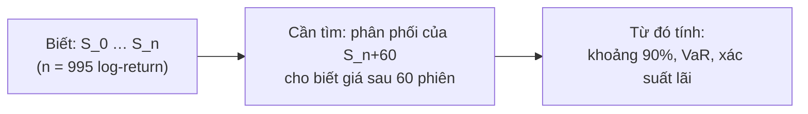

Đơn giản hóa: giá sau $H$ phiên bằng giá hiện tại nhân một hệ số ngẫu nhiên.

$$
S_{n+H} = S_n \cdot e^{R}, \qquad R \sim \mathcal N\big((\mu-\tfrac12\sigma^2)T,\ \sigma^2 T\big), \qquad T = H/252
$$

Ẩn số duy nhất là cặp $(\mu,\sigma)$, ước lượng từ log-return. **Tiêu chí đúng/sai:** dải dự báo 90% phải phủ giá thực khoảng 90% số lần.

### 1.4 Giải quyết gì, làm rõ gì, cho ai

| Làm rõ được | Giúp được việc | Đối tượng |
|---|---|---|
| **Tín hiệu và nhiễu:** xu hướng μ khó ước lượng (sai số ±50%), biến động σ ổn định hơn | Hiểu vì sao dự báo giá rất rộng | Sinh viên, giảng viên môn xác suất/quá trình ngẫu nhiên |
| **Rủi ro là một phân phối**, không phải một con số | Ước lượng mức lỗ có thể xảy ra (VaR, CVaR) | Nhà đầu tư cá nhân, người học quản trị rủi ro |
| **Độ nhạy:** chỉ đổi μ, VaR95 tăng gấp đôi (17,7% → 34,8%) | Phân tích kịch bản "xu hướng tiếp tục" và "không xu hướng" | Nhà phân tích định lượng |
| **Mô hình sai ở đâu, sai bao nhiêu** (độ phủ ~80% thay vì 90%) | Có baseline và quy trình đánh giá để so với mô hình tốt hơn | Người nghiên cứu, xây mô hình |
| Cách tổ chức dự án mô phỏng có test, tái lập được | Mẫu để làm các đề tài tương tự | Lập trình viên, kỹ sư dữ liệu |

Không phù hợp để: giao dịch ngắn hạn theo ngày, đặt "giá mục tiêu", định giá cổ phiếu, thay thế tư vấn tài chính.

---

## 2. Mô hình toán học

### 2.1 GBM và các công thức


| # | Công thức | Dùng để tính | Ý nghĩa đại lượng |
|---|---|---|---|
| 1 | $dS_t=\mu S_t\,dt+\sigma S_t\,dW_t$ | Mô tả giá thay đổi thế nào | $S_t$ giá; $\mu$ độ trôi (xu hướng, /năm); $\sigma$ độ biến động (/năm); $W_t$ chuyển động Brown (nguồn nhiễu) |
| 2 | $S_{t+\Delta t}=S_t\exp\!\big[(\mu-\tfrac12\sigma^2)\Delta t+\sigma\sqrt{\Delta t}\,Z\big]$ | **Sinh giá phiên kế tiếp** trong mô phỏng | $\Delta t=1/252$ (một phiên); $Z\sim\mathcal N(0,1)$ ngẫu nhiên; $-\tfrac12\sigma^2$ là hiệu chỉnh Itô |
| 3 | $\hat\sigma=\dfrac{s_r}{\sqrt{\Delta t}},\quad \hat\mu=\dfrac{\bar r}{\Delta t}+\tfrac12\hat\sigma^2$ | **Ước lượng μ, σ** từ dữ liệu | $\bar r$, $s_r$ trung bình và độ lệch chuẩn mẫu của log-return ngày |
| 4 | $\text{SE}(\hat\mu)\approx\sigma/\sqrt T$ | Độ chính xác của $\hat\mu$ | $T$ độ dài dữ liệu (năm). Với $T\approx1$ thì SE rất lớn |
| 5 | $\mathbb E[g(S_T)]\approx\frac1N\sum_i g\big(S_T^{(i)}\big)$ | **Monte Carlo:** xấp xỉ mọi kỳ vọng | $N=10.000$ quỹ đạo; sai số $\sim1/\sqrt N$ |
| 6 | $\mathrm{VaR}_{95}=-q_{5\%}(R),\ \ \mathrm{CVaR}_{95}=-\mathbb E[R\mid R\le q_{5\%}]$ | **Rủi ro** | $R=S_T/S_0-1$ lợi suất cả kỳ; $q_{5\%}$ phân vị 5% |
| 7 | $\text{PIT}=\mathbb P_{\text{MC}}(S_T<S_{\text{thực}})\sim U(0,1)$ | **Kiểm tra dự báo** ở backtest | Nếu mô hình đúng, PIT phân phối đều; chữ U = đánh giá thấp rủi ro |

Kiểm chứng code: $\mathbb E[S_T]=S_0e^{\mu T}$ và phân vị 5%/95% log-chuẩn phải khớp Monte Carlo (test trong `tests/test_simulation.py`). Trung vị thì **không** phải bằng chứng, vì biến đối ngẫu (mỗi $Z$ kèm $-Z$) làm nó trùng lý thuyết theo cấu trúc.

### 2.2 Phạm vi dữ liệu và năng lực của mô hình

| Phạm vi xử lý | Giá trị |
|---|---|
| Mã, chuỗi | VIC, giá đóng cửa ngày |
| Dữ liệu | 996 phiên, 16/11/2022 → 16/11/2026 |
| Hiệu chỉnh μ, σ | 250 phiên gần nhất (2025-11-12 → 2026-11-16) |
| Dự báo | 60 phiên tới; backtest 20 phiên, 73 mốc cách nhau 10 phiên |

| Trong phạm vi này, công thức **làm được** | **Không** làm được |
|---|---|
| Cho phân phối giá, dải 90%/50%, VaR, CVaR, xác suất lãi/lỗ | Dự đoán một giá điểm chính xác |
| So sánh kịch bản μ lịch sử và μ = 0 | Cho biết xu hướng thật sự của VIC |
| Đo độ phủ và PIT của dự báo | Mô tả cụm biến động, biến động thay đổi theo thời gian, nhảy giá, biên độ ±7% |

---

## 3. Mô phỏng trên máy tính

### 3.1 Lưu đồ giải bài toán

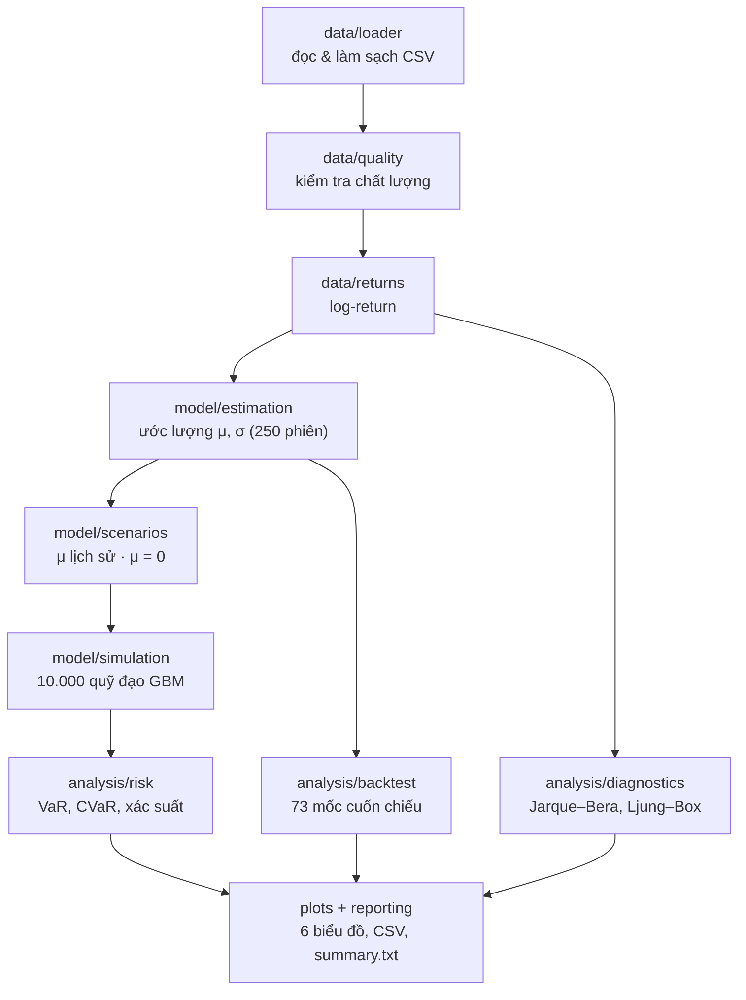

`vicmc/pipeline.py` chỉ điều phối các bước trên; mỗi bước nằm trong đúng một module.

### 3.2 Đại lượng tính được và ý nghĩa

| Đại lượng | Module | Ý nghĩa với VIC | Giá trị |
|---|---|---|---|
| $\hat\mu$, SE | `estimation` | Xu hướng tăng/năm trong 250 phiên gần nhất, kèm độ bất định | 98,3% ± 49,9% |
| $\hat\sigma$ | `estimation` | Mức dao động giá/năm | 49,7% |
| Skew, độ nhọn dư, JB, Ljung–Box | `diagnostics` | Dữ liệu có thỏa giả thiết GBM không | 0,30 · 0,0006 (p) |
| Phân vị 5/25/50/75/95% của $S_T$ | `risk` | Dải giá sau 60 phiên | xem mục 5 |
| VaR95, CVaR95 | `risk` | Mức lỗ có thể xảy ra / lỗ trung bình khi xấu nhất | 17,7%/25,2% (μ̂); 34,8%/40,8% (μ=0) |
| P(lãi), P(lỗ>10%), P(lãi>20%) | `risk` | Xác suất các kết cục cụ thể | xem mục 5 |
| Độ phủ 90%/50%, PIT, KS | `backtest` | Dải dự báo có thật sự phủ giá thực không | 80,8% / 57,5% |

---

## 4. Biểu đồ kết quả

Sinh bởi `python main.py` vào `outputs/figures/`.

| Hình | Giải quyết vấn đề gì |
|---|---|
| 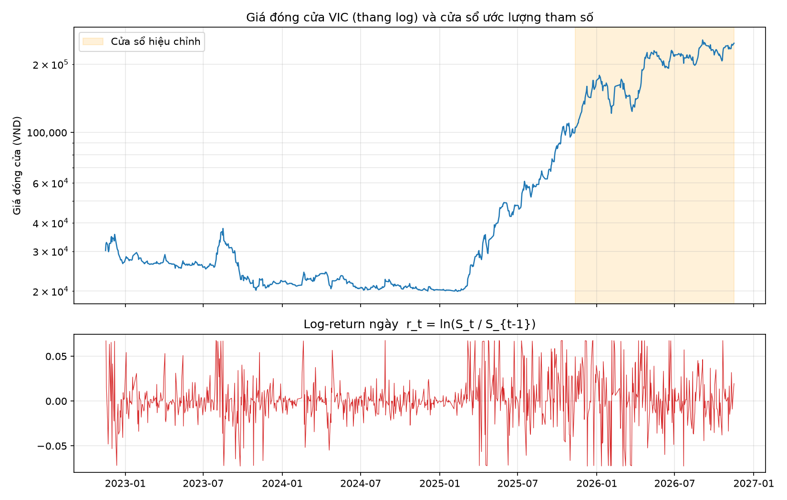 **fig1_history** | Giá (thang log) và log-return: xu hướng 8 lần và các giai đoạn biến động; vùng cam là cửa sổ hiệu chỉnh |
| 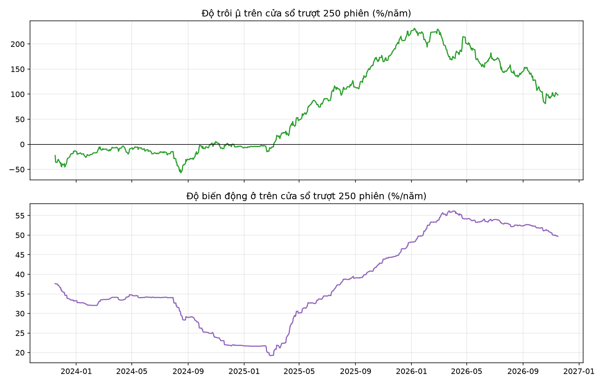 **fig2_rolling_params** | μ̂ và σ̂ trượt: bằng chứng tham số **không** hằng số |
| 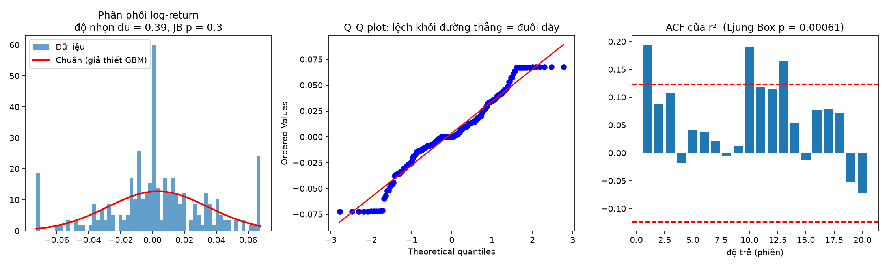 **fig3_diagnostics** | Histogram, Q-Q, ACF của r²: kiểm tra chuẩn và cụm biến động |
| 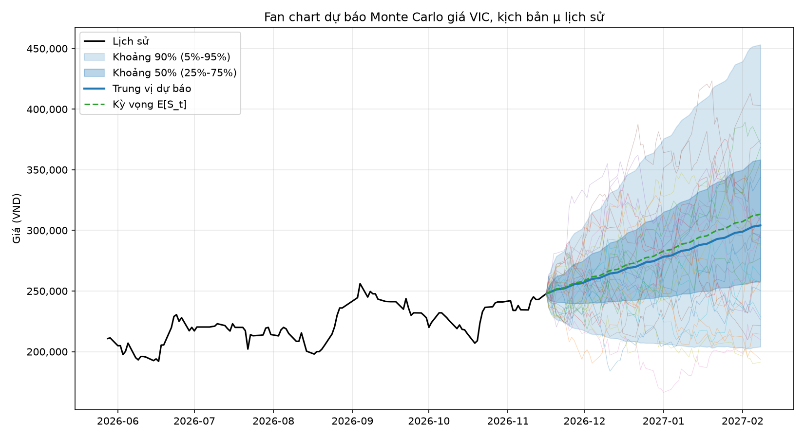 **fig4_fan_chart** | Fan chart 60 phiên tới (μ lịch sử): dải 50%/90% và quỹ đạo mẫu |
| 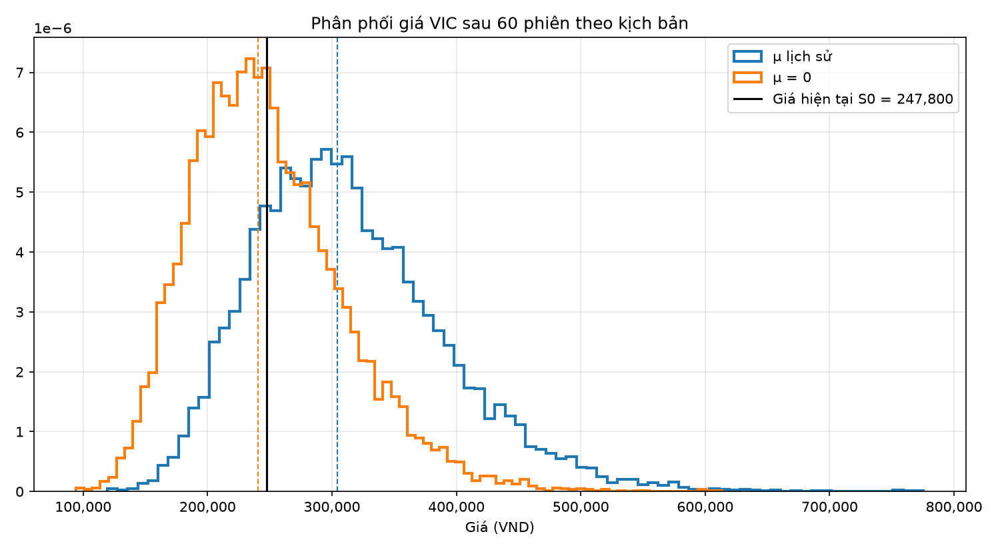 **fig5_terminal_scenarios** | Phân phối giá cuối kỳ hai kịch bản: dự báo nhạy với μ thế nào |
| 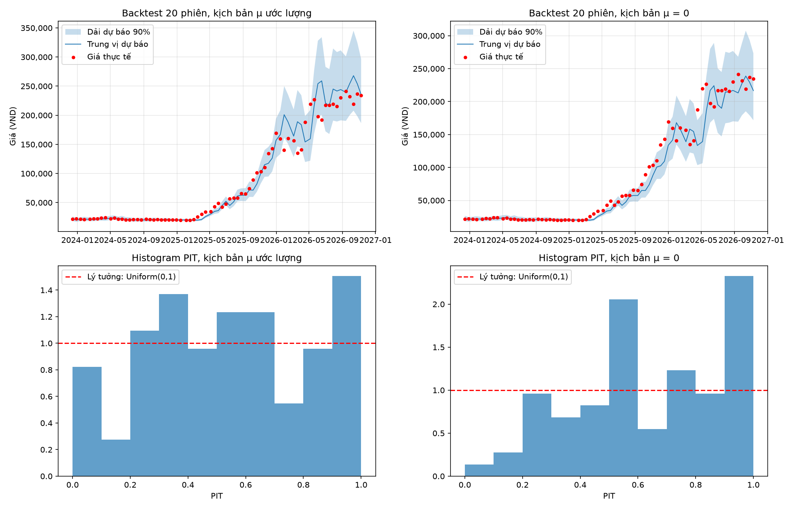 **fig6_backtest** | Giá thực so với dải 90% và histogram PIT: mô hình có đáng tin không |

---

## 5. Phân tích & đánh giá thực tiễn

### 5.1 Kết quả

**Dự báo 60 phiên từ $S_0$ = 247.800 VND** (seed 42, 10.000 quỹ đạo):

| | μ lịch sử | μ = 0 |
|---|---|---|
| Trung vị | 304.093 | 240.626 |
| Khoảng 90% | [204.048 ; 453.190] | [161.461 ; 358.605] |
| VaR95 / CVaR95 | 17,7% / 25,2% | 34,8% / 40,8% |
| P(lãi) | 79,8% | 45,0% |
| P(lỗ > 10%) | 10,2% | 37,5% |

Nhiễu mô phỏng nhỏ (VaR95 dao động ±0,8 điểm phần trăm), nên chênh lệch 17 điểm giữa hai kịch bản là do giả định μ, không phải do ngẫu nhiên.

**Độ nhạy theo cửa sổ hiệu chỉnh** (tái lập bằng `python main.py --calib-days W`):

| Cửa sổ | μ̂ | σ̂ | VaR95 (μ̂) | VaR95 (μ=0) |
|---|---|---|---|---|
| 60 | 96,6% | 36,4% | 7,5% | 26,5% |
| 250 | 98,3% | 49,7% | 17,7% | 34,8% |
| 500 | 136,9% | 47,1% | 7,6% | 33,3% |

**Backtest** (73 mốc, dự báo trước 20 phiên):

| | μ ước lượng | μ = 0 | Lý tưởng |
|---|---|---|---|
| Độ phủ dải 90% | **80,8%** | **79,5%** | 90% |
| Độ phủ dải 50% | 57,5% | 50,7% | 50% |
| Giá thực trên / dưới dải | 13,7% / 5,5% | 20,5% / 0,0% | 5% / 5% |
| KS test của PIT | p = 0,23 | p = 0,002 | p lớn |

Theo năm (μ ước lượng): **2024: 100%** (đi ngang) · **2025: 64%** (tăng nóng, 36% giá thực vượt dải trên) · **2026: 76%** (điều chỉnh, 19% giá thực rơi dưới dải).

### 5.2 Đánh giá: dùng được trong thực tế không?

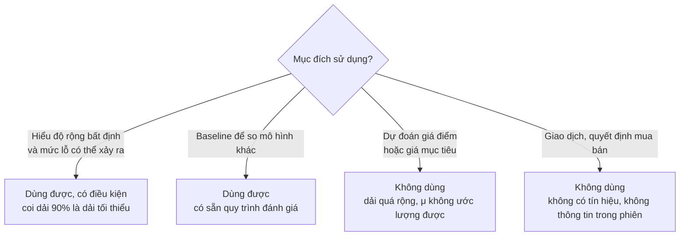

| Kết luận | Lý do ngắn gọn |
|---|---|
| Dải "90%" thực chất chỉ phủ ~80%, nên **đánh giá thấp rủi ro** | Mô hình sai nhiều nhất lúc chuyển chế độ (2025 tăng nóng, 2026 điều chỉnh) |
| Dự báo phụ thuộc mạnh vào μ | SE(μ̂) ≈ ±50% so với chính μ̂ ≈ 98%; đổi μ làm VaR gấp đôi |
| σ̂ của 250 phiên (50%) cao hơn biến động gần đây (33–39%) | GBM với σ hằng số không nắm được biến động đã dịu lại |
| Việc "μ ước lượng" tốt hơn "μ = 0" **không** chứng minh ngoại suy xu hướng là đúng | Một cổ phiếu, một giai đoạn tăng 8 lần; 73 mốc chồng lấn chỉ tương đương ~35 mẫu độc lập |

---

## 6. Hướng mở rộng

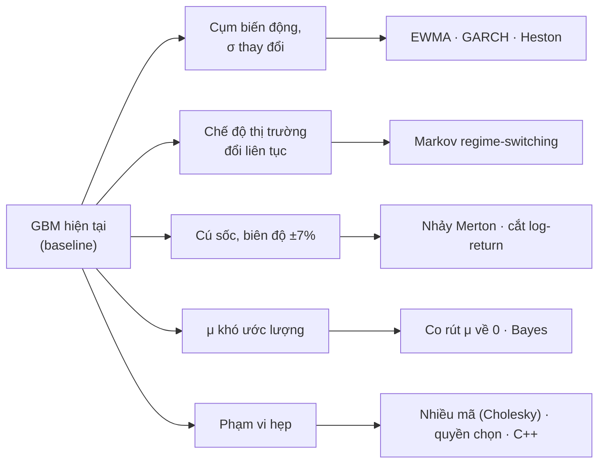

| Hướng | Giải quyết hạn chế nào | Cách làm |
|---|---|---|
| EWMA / GARCH(1,1) | Cụm biến động; σ̂ 250 phiên cao hơn biến động gần đây | $\sigma_t^2=\omega+\alpha r_{t-1}^2+\beta\sigma_{t-1}^2$; thay `estimation.py` và `simulation.py`, so độ phủ backtest với GBM |
| Nhảy Merton | Cú sốc đột ngột, phiên chạm biên | Thêm quá trình Poisson với kích thước nhảy log-chuẩn |
| Regime-switching | μ̂ đổi dấu theo thời gian | 2–3 trạng thái (đi ngang/tăng/giảm), ước lượng bằng Baum–Welch |
| Cắt biên độ ±7% | GBM cho biến động vô hạn trong một phiên | Giới hạn log-return mô phỏng trong $[\ln0{,}93;\ln1{,}07]$ |
| Co rút μ | SE(μ̂) quá lớn | Kéo $\hat\mu$ về 0 hoặc lãi suất phi rủi ro; tiếp cận Bayes |
| Lịch lễ Việt Nam | Ngày tương lai mới chỉ trừ cuối tuần | Thêm ngày lễ vào `future_dates` |
| Danh mục, quyền chọn | Chỉ một mã | Cholesky cho GBM tương quan; định giá với μ = r và so Black–Scholes |
| Port sang C++ | Chạy nhanh, triển khai nhúng | Viết lại `simulate_gbm` bằng `<random>` + `std::mt19937_64` |
| Đánh giá nâng cao | Backtest ít mẫu độc lập | Pinball loss/CRPS, mốc không chồng lấn, kiểm định Christoffersen |

---

## 7. Hạn chế

- **Giả thiết GBM bị vi phạm:** μ, σ không hằng số; có cụm biến động; không có nhảy giá và biên độ ±7%.
- **μ̂ không đáng tin:** tính trên giai đoạn tăng giá rất mạnh nên có thể quá lạc quan; dự án giữ kịch bản μ = 0 để đối chứng.
- **Dữ liệu hẹp:** một mã, một giai đoạn; kết luận không khái quát hóa được.
- **Backtest ít mẫu độc lập:** các mốc chồng lấn nên p-value của KS chỉ mang tính tham khảo.
- **Biến đối ngẫu** gần như không giảm sai số của VaR/CVaR (chỉ 8–18%), dù giảm rất mạnh sai số của $\mathbb E[S_T]$.
- **Ngày tương lai** chưa trừ ngày lễ Việt Nam; phiên cuối 16/11/2026 có thể là số liệu tạm thời.
- **Lỗi đã biết:** bộ đọc dữ liệu hiểu dấu phẩy là phân cách hàng nghìn, nên file dùng dấu phẩy thập phân (`98,5`) sẽ bị đọc thành `985` mà không báo lỗi. File VIC hiện tại không bị ảnh hưởng.

---

## 8. Cấu trúc dự án & cách chạy

### 8.1 Cấu trúc

```
ModelingVingroupStockPriceVolatility_using_MonteCarloSimulation/
├── README.md                 # tài liệu này
├── main.py                   # điểm vào: python main.py
├── requirements.txt          # thư viện để CHẠY: numpy, pandas, matplotlib, scipy
├── requirements-dev.txt      # thêm pytest để KIỂM THỬ
├── pytest.ini
├── .gitignore
├── data/raw/                 # dữ liệu gốc (CSV Investing.com)
├── vicmc/                    # mã nguồn, mỗi file một chức năng
│   ├── config.py             # hằng số + tham số chạy
│   ├── cli.py                # đọc tham số dòng lệnh
│   ├── pipeline.py           # điều phối các bước (chỉ gọi, không tính)
│   ├── data/                 # loader · quality · returns
│   ├── model/                # estimation · simulation · scenarios
│   ├── analysis/             # diagnostics · risk · backtest
│   ├── reporting/            # tables (CSV) · summary (summary.txt)
│   └── plots/                # history · model_checks · forecast · validation
├── tests/                    # 8 test: loader, estimation, simulation, risk, backtest
├── outputs/                  # kết quả do main.py sinh ra
│   ├── figures/              # fig1 … fig6 (.png)
│   ├── tables/               # forecast_*.csv, backtest_*.csv
│   └── summary.txt           # toàn bộ số liệu
└── docs/
    └── TECH_STACK.md         # công nghệ và công cụ hỗ trợ
```

### 8.2 Cài đặt & chạy bằng một lệnh

Yêu cầu: **Python 3.10 trở lên**. Mở terminal tại thư mục dự án rồi chạy **một** dòng tương ứng hệ điều hành:

| Hệ điều hành | Lệnh |
|---|---|
| macOS / Linux | `python3 -m venv .venv && source .venv/bin/activate && pip install -r requirements.txt && python main.py` |
| Windows (cmd) | `python -m venv .venv && .venv\Scripts\activate && pip install -r requirements.txt && python main.py` |
| Windows (PowerShell) | `python -m venv .venv; .venv\Scripts\Activate.ps1; pip install -r requirements.txt; python main.py` |
| Không dùng môi trường ảo | `pip install -r requirements.txt && python main.py` |

Chỉ muốn cài thư viện bằng đúng một lệnh: `pip install numpy pandas matplotlib scipy`.

Kết quả ghi vào `outputs/` (6 hình, 4 bảng CSV và `summary.txt`); tóm tắt cũng in ra màn hình.

Kiểm thử: `pip install -r requirements-dev.txt && python -m pytest` (8 test, khoảng 2 giây).

### 8.3 Tham số tùy chọn

```bash
python main.py --horizon 40 --paths 20000 --calib-days 500
```

| Tham số | Mặc định | Ý nghĩa |
|---|---|---|
| `--calib-days` | 250 | Số phiên ước lượng μ, σ (cũng dùng cho backtest) |
| `--horizon` | 60 | Số phiên dự báo |
| `--paths` | 10000 | Số quỹ đạo Monte Carlo |
| `--bt-horizon`, `--bt-step` | 20, 10 | Backtest: dự báo trước bao nhiêu phiên, cách nhau bao nhiêu phiên |
| `--data`, `--start`, `--end`, `--seed`, `--out` | | File CSV, khoảng ngày, hạt giống, thư mục kết quả |

---

## 9. Thành viên & vai trò

| STT | Họ tên | MSSV | Vai trò |
|---|---|---|---|
| 1 | *(dev tự điền)* | | |
| 2 | *(dev tự điền)* | | |
| 3 | *(dev tự điền)* | | |

---

## 10. Công nghệ & công cụ

| Nhóm | Sử dụng |
|---|---|
| Ngôn ngữ | Python 3.10+ (chạy thử trên 3.12) |
| Thư viện | NumPy, pandas, SciPy, Matplotlib; pytest để kiểm thử |
| Dữ liệu | Investing.com (CSV lịch sử VIC) |
| Sơ đồ & tài liệu | Mermaid, Markdown |
| Hỗ trợ | Trợ lý AI Claude (hỗ trợ viết và rà soát code, tài liệu) |

Chi tiết và phiên bản: xem [`docs/TECH_STACK.md`](docs/TECH_STACK.md).
