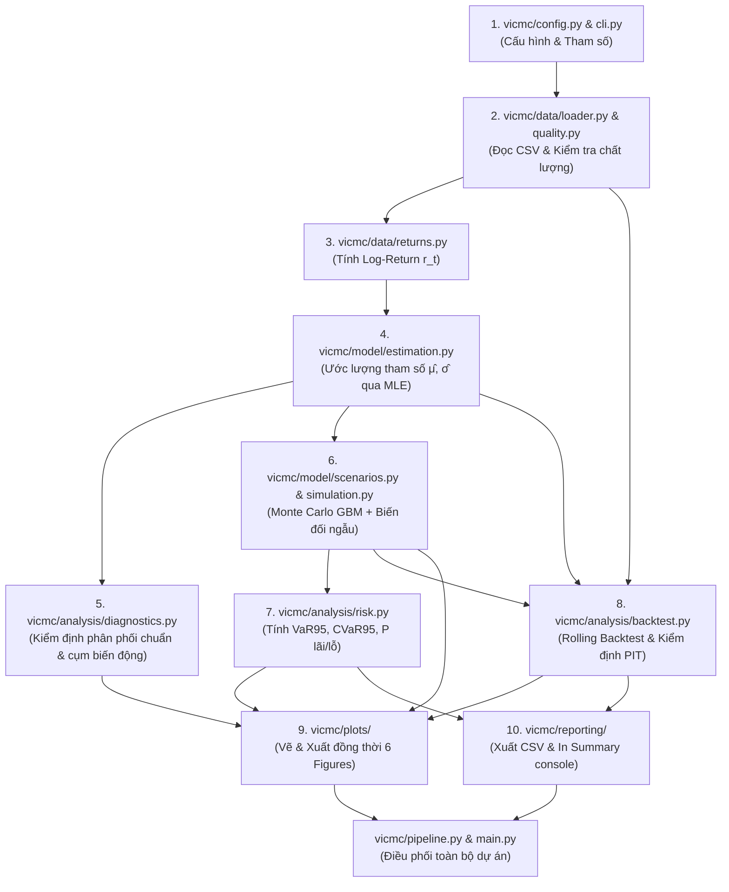

# TÀI LIỆU NGHIÊN CỨU SÂU VÀ GIẢI THÍCH TOÀN BỘ DỰ ÁN
## Mô Hình Hóa Biến Động Giá Cổ Phiếu VIC Bằng Mô Phỏng Monte Carlo (GBM)
**Kho mã nguồn**: `https://github.com/Yuno-20EA/ModelingVingroupStockPriceVolatility_using_MonteCarloSimulation.git`

---

> [!NOTE]
> **Quy ước tài liệu**:
> - **Cột bên trái**: Code mẫu chép nguyên bản từ file thực tế của dự án.
> - **Cột bên phải**: Lời giải thích bằng ngôn ngữ đơn giản, trực quan, bám sát từng dòng lệnh theo đúng thứ tự chạy.
> - **Ghi chú màu xanh lá** trong code (các dòng `# ...`) là chú thích nguyên bản của lập trình viên giúp người đọc định hướng nhanh.
> - **Cấu trúc mỗi file**: Đảm bảo đủ 5 mục nghiên cứu cốt lõi:
>   1. **Nó làm gì?**
>   2. **Từng đoạn code chạy theo thứ tự nào?** (Bảng đối chiếu Code thật vs Giải thích)
>   3. **Đầu ra của file là gì?**
>   4. **Vì sao phải dùng nó?**
>   5. **Kết quả đó giúp so sánh hai phương pháp ra sao?** ($\mu$ ước lượng lịch sử vs $\mu = 0$).

---



---

## 1. FILE: `vicmc/config.py`

### (1) Nó làm gì?
File này đóng vai trò là "trung tâm đầu não cấu hình", lưu trữ tất cả các hằng số toán học, đường dẫn mặc định và các tham số mô phỏng Monte Carlo để toàn bộ dự án dùng chung thống nhất.

### (2) Từng đoạn code chạy theo thứ tự nào?

| Code thực tế (`vicmc/config.py`) | Giải thích chi tiết theo thứ tự chạy |
| :--- | :--- |
| ```python<br># Cấu hình tham số và hằng số toàn dự án<br>from dataclasses import dataclass<br>from pathlib import Path<br><br>ROOT = Path(__file__).resolve().parent.parent<br>TRADING_DAYS = 252           # Số phiên giao dịch/năm<br>DT = 1 / TRADING_DAYS        # Quy đổi 1 phiên sang năm<br>``` | **Bước 1: Khai báo hằng số vật lý/toán tài chính**<br>- `ROOT`: Tự động tìm thư mục gốc của dự án.<br>- `TRADING_DAYS = 252`: Thị trường chứng khoán Việt Nam (HOSE) giao dịch trung bình 252 phiên mỗi năm (bỏ thứ 7, CN và ngày lễ).<br>- `DT = 1 / 252`: Quy đổi một bước thời gian $\Delta t$ (1 phiên) ra đơn vị năm để chuẩn hóa các công thức vi phân ngẫu nhiên Itô. |
| ```python<br>@dataclass(frozen=True)<br>class Config:<br>    data_path: Path = ROOT / "data" / "raw" / "VIC_2022-11-16_2026-11-16.csv"<br>    data_start: str | None = None    # Ngày bắt đầu (None: lấy từ đầu)<br>    data_end: str | None = None      # Ngày kết thúc (None: lấy đến cuối)<br>    calib_days: int = 250            # Cửa sổ ước lượng μ, σ (~1 năm)<br>    horizon: int = 60                # Số phiên dự báo (~3 tháng)<br>    n_paths: int = 10_000            # Số quỹ đạo mô phỏng (chẵn)<br>    seed: int = 42                   # Hạt giống ngẫu nhiên<br>    bt_horizon: int = 20             # Backtest: dự báo trước 20 phiên<br>    bt_step: int = 10                # Backtest: bước trượt 10 phiên<br>    bt_paths: int = 2_000            # Backtest: số quỹ đạo mỗi mốc<br>    out_dir: Path = ROOT / "outputs"<br>    show_plots: bool = True          # Hiển thị đồng thời 6 figure<br>``` | **Bước 2: Tạo lớp dữ liệu cấu hình bất biến (`frozen=True`)**<br>- `calib_days = 250`: Lấy 250 phiên gần nhất (khoảng 1 năm) làm mẫu hiệu chỉnh tính $\hat\mu, \hat\sigma$.<br>- `horizon = 60`: Mô phỏng tương lai 60 phiên (~3 tháng giao dịch).<br>- `n_paths = 10_000`: Sinh $10.000$ kịch bản giá ngẫu nhiên (đảm bảo độ hội tụ $\approx 1/\sqrt{N} = 1\%$).<br>- `seed = 42`: Cố định bộ sinh số ngẫu nhiên để kết quả chạy lại luôn khớp 100%.<br>- `show_plots = True`: Điều khiển bật pop-up cả 6 cửa sổ biểu đồ. |

### (3) Đầu ra của file là gì?
- Đối tượng `Config` chứa toàn bộ tham số mặc định của hệ thống.

### (4) Vì sao phải dùng nó?
- Tránh "Magic Numbers" (các con số viết cứng rải rác trong code). Khi cần đổi số quỹ đạo hay đổi ngày dự báo, chỉ cần đổi tại 1 nơi duy nhất.
- `@dataclass(frozen=True)` ngăn ngừa việc vô tình sửa đổi tham số giữa chừng trong lúc chạy thuật toán.

### (5) Kết quả đó giúp so sánh hai phương pháp ra sao?
- Đảm bảo tính **công bằng tuyệt đối**: Cả phương pháp $\mu$ ước lượng và phương pháp $\mu = 0$ đều dùng chung $\Delta t$, chung độ dài dữ liệu hiệu chỉnh ($250$ ngày), chung tầm dự báo ($60$ ngày) và cùng số quỹ đạo ($10.000$).

---

## 2. FILE: `vicmc/data/loader.py`

### (1) Nó làm gì?
Đọc file CSV lịch sử giá cổ phiếu VIC tải từ Investing.com (giao diện tiếng Việt), xử lý các ký tự đặc biệt (dấu phẩy, dấu `%`, hậu tố khối lượng `M`, `K`), chuẩn hóa tên cột và lọc theo khoảng thời gian.

### (2) Từng đoạn code chạy theo thứ tự nào?

| Code thực tế (`vicmc/data/loader.py`) | Giải thích chi tiết theo thứ tự chạy |
| :--- | :--- |
| ```python<br># Đọc và làm sạch dữ liệu CSV lịch sử giá VIC<br>import re<br>import pandas as pd<br><br>_COLUMNS = {"ngày": "date", "lần cuối": "close", "mở": "open", "cao": "high", "thấp": "low",<br>            "kl": "volume", "% thay đổi": "src_pct",<br>            "date": "date", "time": "date", "close": "close"}<br>_UNIT = {"": 1.0, "K": 1e3, "M": 1e6, "B": 1e9}<br>``` | **Bước 1: Ánh xạ từ điển tiếng Việt sang chuẩn quốc tế**<br>- Dữ liệu tải từ trang tiếng Việt có cột tên là "Lần cuối", "Mở", "KL"... Từ điển chuyển hết về tên tiếng Anh chuẩn (`close`, `open`, `volume`) để code phía sau xử lý nhất quán. |
| ```python<br>def _number(s: pd.Series) -> pd.Series:<br>    # Chuyển chuỗi định dạng số có dấu phẩy sang float (ví dụ: '247,800' -> 247800.0)<br>    return pd.to_numeric(s.str.replace(",", "", regex=False).str.strip(), errors="coerce")<br><br>def _volume(s: pd.Series) -> pd.Series:<br>    # Chuyển khối lượng có ký hiệu K/M/B sang float (ví dụ: '1.21M' -> 1210000.0)<br>    def one(x: str) -> float:<br>        m = re.fullmatch(r"\s*([\d.,]+)\s*([KMBkmb]?)\s*", x)<br>        return float(m.group(1).replace(",", "")) * _UNIT[m.group(2).upper()] if m else float("nan")<br>    return s.map(one)<br>``` | **Bước 2: Xử lý chuỗi văn bản thành số học**<br>- `_number`: Xóa dấu phẩy phân cách hàng nghìn (Việt Nam hay dùng `247,800` thay vì `247800`).<br>- `_volume`: Biến các ký hiệu viết tắt như `1.21M` thành số thực `1,210,000` bằng Regex. |
| ```python<br>def load_ohlcv(path) -> pd.DataFrame:<br>    # Đọc CSV, chuẩn hóa tên cột, chuyển đổi kiểu dữ liệu và sắp xếp tăng dần theo ngày<br>    raw = pd.read_csv(path, encoding="utf-8-sig", dtype=str)<br>    raw.columns = [c.strip().lower() for c in raw.columns]<br>    raw = raw.rename(columns={c: _COLUMNS[c] for c in raw.columns if c in _COLUMNS})<br>    if not {"date", "close"} <= set(raw.columns):<br>        raise ValueError(f"Thiếu cột ngày/giá đóng cửa...")<br>    df = pd.DataFrame(index=_dates(raw["date"]))<br>    # Ép kiểu các cột và loại bỏ dữ liệu lỗi/trùng lặp<br>    df = df.sort_index()<br>    df = df[~df.index.duplicated(keep="last")].dropna(subset=["close"])<br>    return df[df["close"] > 0]<br>``` | **Bước 3: Tải bảng dữ liệu và sắp xếp trình tự thời gian**<br>- File gốc của sàn chứng khoán thường xếp ngày mới nhất lên đầu dòng. Đoạn code `df.sort_index()` đảo ngược lại theo thứ tự từ quá khứ đến hiện tại để mô phỏng đi tới tương lai. Xóa các dòng trùng lặp hoặc giá âm. |

### (3) Đầu ra của file là gì?
- Một `pd.DataFrame` có chỉ mục (index) là Datetime, chứa các cột `close`, `open`, `high`, `low`, `volume`, sắp xếp tăng dần theo ngày.

### (4) Vì sao phải dùng nó?
- "Garbage In, Garbage Out": Mô hình toán tài chính rất nhạy cảm. Dữ liệu gốc luôn có khoảng trắng, chuỗi rác, sai định dạng ngày tháng. Nếu không làm sạch, toàn bộ mô phỏng phía sau sẽ sụp đổ.

### (5) Kết quả đó giúp so sánh hai phương pháp ra sao?
- Cung cấp chuỗi giá đóng cửa sạch $S_t$ đồng nhất làm cơ sở dữ liệu gốc để từ đó phân nhánh tính toán cho cả 2 kịch bản $\mu$.

---

## 3. FILE: `vicmc/data/quality.py` & `returns.py`

### (1) Nó làm gì?
- `quality.py`: Rà soát chất lượng dữ liệu: kiểm tra xem có ngày nào biến động vượt trần/sàn $\pm 7\%$ của HOSE không, có bị gián đoạn nghỉ lễ dài ngày không, và có sự kiện chia tách cổ tức chưa điều chỉnh không.
- `returns.py`: Tính chuỗi tỷ suất sinh lời logarit (log-returns): $r_t = \ln(S_t / S_{t-1})$.

### (2) Từng đoạn code chạy theo thứ tự nào?

| Code thực tế (`quality.py` & `returns.py`) | Giải thích chi tiết theo thứ tự chạy |
| :--- | :--- |
| ```python<br># vicmc/data/returns.py<br>def log_returns(prices: pd.Series) -> np.ndarray:<br>    # Tính r_t = ln(S_t / S_{t-1})<br>    return np.log(prices).diff().dropna().values<br>``` | **Bước 1: Tính Log-Return ngày**<br>- Lấy logarit tự nhiên của giá rồi lấy sai phân bậc 1: $\ln(S_t) - \ln(S_{t-1}) = \ln(S_t / S_{t-1})$.<br>- Đây là biến ngẫu nhiên cơ sở của mô hình hình học Brown (GBM). |
| ```python<br># vicmc/data/quality.py<br>def check_quality(df: pd.DataFrame) -> DataQuality:<br>    close = df["close"]<br>    r = np.log(close).diff().dropna()<br>    gaps = df.index.to_series().diff().dt.days.dropna()<br>    mismatch = None<br>    if "src_pct" in df:<br>        mismatch = int(((df["src_pct"] - close.pct_change() * 100).abs().iloc[1:] > 0.1).sum())<br>    return DataQuality(...)<br>``` | **Bước 2: Kiểm định độ liên tục và tính toàn vẹn**<br>- Tính khoảng trống giữa 2 phiên liên tiếp `gaps`. Nếu $>4$ ngày thì ghi nhận (thường là dịp Tết âm lịch).<br>- Kiểm tra tính nhất quán giữa cột `% thay đổi` do nguồn cung cấp và tỷ lệ tự tính. Nếu lệch $>0.1\%$ thì có thể mã đã trải qua chia tách cổ phiếu hoặc trả cổ tức lớn mà chưa điều chỉnh giá cũ. |

### (3) Đầu ra của file là gì?
- Mảng NumPy 1D chứa chuỗi số thực $r_t$.
- Đối tượng `DataQuality` chứa các thông số: biên độ lớn nhất, số phiên đụng trần/sàn, số ngày trống tối đa.

### (4) Vì sao phải dùng nó?
- **Tại sao dùng Log-return thay vì Simple return $(S_t - S_{t-1})/S_{t-1}$?**
  1. *Tính cộng dồn theo thời gian*: Log-return $k$ ngày bằng tổng log-return từng ngày: $r_{0 \to k} = \sum_{t=1}^k r_t$.
  2. *Không âm*: Giá cổ phiếu thực tế không thể âm. Trong mô hình hình học Brown, giá $S_t = S_0 e^{\sum r_t} > 0$ luôn được đảm bảo dương nghiêm ngặt.

### (5) Kết quả đó giúp so sánh hai phương pháp ra sao?
- Đảm bảo độ tin cậy của dữ liệu đầu vào. Xác nhận dữ liệu không bị lỗi kỹ thuật trước khi đưa vào kiểm định tính chuẩn của 2 phương pháp.

---

## 4. FILE: `vicmc/model/estimation.py`

### (1) Nó làm gì?
Ước lượng hai tham số trọng tâm của mô hình hình học Brown: **độ trôi ($\mu$)** và **độ biến động ($\sigma$)** từ dữ liệu mẫu bằng phương pháp Hợp lý Cực đại (Maximum Likelihood Estimation - MLE), quy đổi ra đơn vị năm (/năm). Đồng thời tính tham số trượt (rolling window) để kiểm tra tính ổn định.

### (2) Từng đoạn code chạy theo thứ tự nào?

| Code thực tế (`vicmc/model/estimation.py`) | Giải thích chi tiết theo thứ tự chạy |
| :--- | :--- |
| ```python<br>def estimate_gbm(prices: pd.Series) -> GBMParams:<br>    # Ước lượng MLE: σ̂ = std(r)/√dt, μ̂ = mean(r)/dt + σ̂²/2, SE(μ̂) ≈ σ/√T<br>    r = log_returns(prices)<br>    sigma = r.std(ddof=1) / np.sqrt(DT)<br>    mu = r.mean() / DT + 0.5 * sigma**2<br>    return GBMParams(len(r), mu, sigma, sigma / np.sqrt(len(r) * DT), prices.index[0], prices.index[-1])<br>``` | **Bước 1: Ước lượng điểm (Point Estimation)**<br>- $\hat\sigma = \frac{s_r}{\sqrt{\Delta t}}$: Độ biến động năm hóa bằng độ lệch chuẩn ngày chia cho $\sqrt{1/252}$.<br>- $\hat\mu = \frac{\bar r}{\Delta t} + \frac{1}{2}\hat\sigma^2$: Bổ đề Itô đòi hỏi cộng thêm số hạng lồi $\frac{1}{2}\sigma^2$ (Itô's correction term).<br>- Sai số chuẩn: $\text{SE}(\hat\mu) \approx \frac{\sigma}{\sqrt{T}}$. Vì $T \approx 1$ năm nên sai số của $\hat\mu$ cực kỳ lớn ($\pm 50\%$). |
| ```python<br>def rolling_estimates(prices: pd.Series, window: int) -> pd.DataFrame:<br>    # Tính (μ̂, σ̂) trên cửa sổ trượt để kiểm tra tính ổn định theo thời gian<br>    r = np.log(prices).diff().dropna()<br>    sigma = r.rolling(window).std() / np.sqrt(DT)<br>    return pd.DataFrame({"mu": r.rolling(window).mean() / DT + 0.5 * sigma**2, "sigma": sigma}).dropna()<br>``` | **Bước 2: Đo lường tính biến thiên theo thời gian**<br>- Trượt cửa sổ 250 ngày qua toàn bộ lịch sử 4 năm.<br>- Nếu giả định GBM đúng thì đường $\hat\mu(t)$ và $\hat\sigma(t)$ phải nằm ngang phẳng. Thực tế trên đồ thị sẽ thấy chúng biến động dữ dội. |

### (3) Đầu ra của file là gì?
- `GBMParams`: Chứa các giá trị cụ thể như $\hat\mu = 0.9832$ ($98.3\%$/năm), $\hat\sigma = 0.4968$ ($49.7\%$/năm), và sai số chuẩn $\text{SE}(\hat\mu) = \pm 0.499$.
- `DataFrame` các tham số trượt theo từng ngày.

### (4) Vì sao phải dùng nó?
- Mô hình GBM cần 2 tham số đầu vào duy nhất: $\mu$ (xu hướng tăng trưởng) và $\sigma$ (mức độ rung lắc). Đây là cầu nối giữa dữ liệu thực tế và mô hình toán học.

### (5) Kết quả đó giúp so sánh hai phương pháp ra sao?
- Đây chính là **nút thắt khoa học quan trọng nhất của đề tài**:
  - Phương pháp 1: Tin tưởng hoàn toàn vào $\hat\mu_{\text{ước lượng}} = 0.9832$ (dự báo giá tăng vọt dựa trên quá khứ gần).
  - Phương pháp 2: Nhận thấy sai số chuẩn của $\hat\mu$ quá lớn ($\text{SE} \approx 0.50$), biến động trượt thất thường, nên đặt $\mu = 0$ (trung lập xu hướng, chỉ tập trung mô hình hóa rủi ro biên độ $\sigma$).

---

## 5. FILE: `vicmc/model/simulation.py`

### (1) Nó làm gì?
Đây là "trái tim" tính toán của toàn bộ dự án: Sinh $N$ quỹ đạo giá ngẫu nhiên theo phương trình vi phân ngẫu nhiên GBM bằng **nghiệm giải tích chính xác**, kết hợp kỹ thuật giảm phương sai **biến đối ngẫu (Antithetic Variates)**.

### (2) Từng đoạn code chạy theo thứ tự nào?

| Code thực tế (`vicmc/model/simulation.py`) | Giải thích chi tiết theo thứ tự chạy |
| :--- | :--- |
| ```python<br>def simulate_gbm(s0: float, mu: float, sigma: float, horizon: int,<br>                 n_paths: int, rng: np.random.Generator) -> np.ndarray:<br>    # Sinh quỹ đạo GBM theo nghiệm giải tích chính xác, kết hợp biến đối ngẫu<br>    if n_paths % 2:<br>        raise ValueError("n_paths phải là số chẵn")<br>    z = rng.standard_normal((n_paths // 2, horizon))<br>    z = np.vstack([z, -z])<br>``` | **Bước 1: Sinh số ngẫu nhiên đối ngẫu (Antithetic Variates)**<br>- Chỉ sinh ngẫu nhiên một nửa số quỹ đạo: $Z \sim \mathcal{N}(0, 1)$ với kích thước $(\frac{N}{2}, H)$.<br>- Nửa còn lại lấy đối xứng gương: $-Z$. Ghép hai nửa lại thành mảng đủ $N$ hàng.<br>- *Mục đích*: Triệt tiêu sai số mẫu của số hạng ngẫu nhiên, giúp trung bình mẫu của $Z$ luôn bằng $0$ tuyệt đối, tăng tốc độ hội tụ gấp nhiều lần. |
| ```python<br>    log_steps = (mu - 0.5 * sigma**2) * DT + sigma * np.sqrt(DT) * z<br>    paths = s0 * np.exp(np.cumsum(log_steps, axis=1))<br>    return np.hstack([np.full((n_paths, 1), s0), paths])<br>``` | **Bước 2: Tính toán ma trận quỹ đạo giá**<br>- Bước nhảy logarit: $\Delta \ln S = \left(\mu - \frac{1}{2}\sigma^2\right)\Delta t + \sigma\sqrt{\Delta t} Z$.<br>- `np.cumsum`: Tính tổng dồn theo từng bước thời gian để ra đường đi liên tục.<br>- `s0 * np.exp(...)`: Nghịch đảo hàm log để chuyển về giá tiền VND.<br>- Thêm cột giá hiện tại $S_0$ vào vị trí đầu tiên (cột 0). |

### (3) Đầu ra của file là gì?
- Ma trận 2D kích thước `(n_paths, horizon + 1)` (tức là $10.000 \times 61$). Hàng $i$ là quỹ đạo giá thứ $i$, cột $t$ là giá cổ phiếu ở phiên thứ $t$.

### (4) Vì sao phải dùng nó?
- Nghiệm giải tích chính xác của GBM:
  $$S_t = S_0 \exp\left(\left(\mu - \frac{1}{2}\sigma^2\right)t + \sigma W_t\right)$$
  không mắc sai số rời rạc hóa (discretization error) như phương pháp Euler-Maruyama.
- Biến đối ngẫu giúp kỳ vọng mô phỏng hội tụ cực nhanh về lý thuyết.

### (5) Kết quả đó giúp so sánh hai phương pháp ra sao?
- Ma trận quỹ đạo của phương pháp $\mu = 0$ sẽ dao động quanh mức giá khởi điểm $S_0$, dải phân vị mở rộng hình chiếc phễu cân xứng.
- Ma trận quỹ đạo của phương pháp $\hat\mu$ bị uốn cong chếch lên phía trên do hệ số trôi dương lớn.

---

## 6. FILE: `vicmc/model/scenarios.py`

### (1) Nó làm gì?
Xây dựng 2 kịch bản phân tích ($\hat\mu$ lịch sử và $\mu = 0$), đồng thời áp dụng kỹ thuật **Common Random Numbers (CRN - Dùng chung số ngẫu nhiên)** khi chạy mô phỏng 2 kịch bản.

### (2) Từng đoạn code chạy theo thứ tự nào?

| Code thực tế (`vicmc/model/scenarios.py`) | Giải thích chi tiết theo thứ tự chạy |
| :--- | :--- |
| ```python<br># Thiết lập các kịch bản độ trôi (drift scenarios) để so sánh<br>@dataclass(frozen=True)<br>class Scenario:<br>    name: str   # Tên hiển thị<br>    slug: str   # Tên định danh file<br>    mu: float<br><br>def build_scenarios(params: GBMParams) -> list[Scenario]:<br>    # Kịch bản 1: μ lịch sử (ước lượng từ mẫu); Kịch bản 2: μ = 0 (trung lập rủi ro)<br>    return [Scenario("μ lịch sử", "mu_hat", params.mu), Scenario("μ = 0", "mu_zero", 0.0)]<br>``` | **Bước 1: Khởi tạo 2 kịch bản so sánh đối đầu**<br>- Kịch bản 1: Giữ nguyên độ trôi thực tế $\hat\mu = 0.9832$.<br>- Kịch bản 2: Giả định độ trôi $\mu = 0.0$. |
| ```python<br>def run_scenarios(s0: float, sigma: float, scenarios: list[Scenario],<br>                  horizon: int, n_paths: int, seed: int) -> dict[str, np.ndarray]:<br>    # Chạy mô phỏng dùng chung số ngẫu nhiên (CRN) để loại trừ sai số mẫu khi so sánh<br>    return {sc.slug: simulate_gbm(s0, sc.mu, sigma, horizon, n_paths, np.random.default_rng(seed))<br>            for sc in scenarios}<br>``` | **Bước 2: Mô phỏng với cùng một bộ nhiễu ngẫu nhiên (CRN)**<br>- Điểm mấu chốt: Cả 2 kịch bản cùng được truyền vào `seed` giống nhau (`np.random.default_rng(seed)`).<br>- Điều này có nghĩa: Quỹ đạo số $k$ ở kịch bản $\hat\mu$ và quỹ đạo số $k$ ở kịch bản $\mu = 0$ nhận chung một dãy cú sốc thị trường $Z_1, Z_2, \dots, Z_H$. |

### (3) Đầu ra của file là gì?
- Từ điển Python chứa ma trận quỹ đạo của 2 kịch bản: `{"mu_hat": paths_1, "mu_zero": paths_2}`.

### (4) Vì sao phải dùng nó?
- **Kỹ thuật Common Random Numbers (CRN)**: Trong lý thuyết thống kê mô phỏng, nếu bạn dùng 2 hạt giống ngẫu nhiên khác nhau để so sánh 2 kịch bản, sự khác biệt giữa chúng có thể đến từ việc hạt giống 1 gặp "vận may" sinh ra nhiều số dương hơn hạt giống 2. Việc cố định cùng một chuỗi số ngẫu nhiên giúp loại bỏ hoàn toàn sai số mẫu (noise), đảm bảo **mọi khác biệt quan sát được 100% bắt nguồn từ tham số $\mu$**.

### (5) Kết quả đó giúp so sánh hai phương pháp ra sao?
- Cho phép đặt 2 kịch bản lên cùng một bàn cân vi mô: ta có thể so sánh trực tiếp từng quỹ đạo cặp tương ứng giữa $\hat\mu$ và $\mu=0$.

---

## 7. FILE: `vicmc/analysis/diagnostics.py`

### (1) Nó làm gì?
Kiểm định tính hợp lệ của các giả thiết nền tảng trong mô hình GBM:
1. Giả thiết phân phối chuẩn của log-returns (qua Skewness, Kurtosis và Jarque-Bera).
2. Giả thiết phương sai không đổi và tính độc lập (qua tự tương quan ACF của $r^2$ và kiểm định Ljung-Box).

### (2) Từng đoạn code chạy theo thứ tự nào?

| Code thực tế (`vicmc/analysis/diagnostics.py`) | Giải thích chi tiết theo thứ tự chạy |
| :--- | :--- |
| ```python<br>def acf(x: np.ndarray, nlags: int) -> np.ndarray:<br>    # Tính hệ số tự tương quan mẫu đến độ trễ nlags<br>    x = x - x.mean()<br>    return np.array([np.sum(x[k:] * x[:-k]) for k in range(1, nlags + 1)]) / np.sum(x * x)<br>``` | **Bước 1: Tính hàm tự tương quan mẫu (ACF)**<br>- Đo lường mức độ tương quan giữa biến động hôm nay và các phiên trước đó (từ độ trễ $k=1$ đến $20$ phiên). |
| ```python<br>def run_diagnostics(r: np.ndarray, nlags: int = 20) -> Diagnostics:<br>    n = len(r)<br>    ac_sq = acf(r**2, nlags)<br>    q = n * (n + 2) * np.sum(ac_sq**2 / (n - np.arange(1, nlags + 1)))<br>    return Diagnostics(float(stats.skew(r)), float(stats.kurtosis(r)), float(stats.jarque_bera(r)[1]),<br>                       ac_sq, float(q), float(stats.chi2.sf(q, nlags)), float(1.96 / np.sqrt(n)))<br>``` | **Bước 2: Tính thống kê kiểm định giả thiết**<br>- `stats.skew`: Độ lệch (chuẩn là 0).<br>- `stats.kurtosis`: Độ nhọn dư (Excess Kurtosis, chuẩn là 0, nếu $>0$ là đuôi dày - fat tails).<br>- `stats.jarque_bera`: Trả về $p$-value kiểm định phân phối chuẩn.<br>- `q`: Thống kê Ljung-Box trên chuỗi $r^2$. Nếu $p < 0.05$, bác bỏ giả thiết phương sai độc lập, chứng minh có hiện tượng **cụm biến động (volatility clustering)**. |

### (3) Đầu ra của file là gì?
- Đối tượng `Diagnostics` chứa: `skew = -0.141`, `excess_kurt = 0.393`, `jb_p = 0.296`, `lb_p = 0.000605`.

### (4) Vì sao phải dùng nó?
- Bất kỳ mô hình định lượng nào cũng đi kèm giả định. Kiểm định chẩn đoán giúp xác định phạm vi tin cậy và giới hạn của mô hình trong thực tế.

### (5) Kết quả đó giúp so sánh hai phương pháp ra sao?
- Kết quả Ljung-Box có $p = 0.000605 \ll 0.05$ khẳng định chuỗi biến động giá VIC có cụm biến động (ARCH effect). Điều này chứng minh rằng việc cố gắng ngoại suy một độ trôi cố định $\hat\mu$ từ quá khứ là rất rủi ro, ủng hộ quan điểm thận trọng của phương pháp $\mu = 0$.

---

## 8. FILE: `vicmc/analysis/risk.py`

### (1) Nó làm gì?
Tính toán các chỉ số đo lường rủi ro và xác suất từ phân phối giá cuối kỳ $S_T$ sau 60 phiên: Giá trị kỳ vọng $E[S_T]$, Trung vị (Median), Khoảng tin cậy 90%, **VaR 95% (Value at Risk)**, **CVaR 95% (Conditional Value at Risk / Expected Shortfall)**, và xác suất lãi/lỗ.

### (2) Từng đoạn code chạy theo thứ tự nào?

| Code thực tế (`vicmc/analysis/risk.py`) | Giải thích chi tiết theo thứ tự chạy |
| :--- | :--- |
| ```python<br>def risk_metrics(paths: np.ndarray, mu: float, sigma: float) -> RiskMetrics:<br>    # Tính toán toàn bộ các thước đo thống kê và rủi ro từ ma trận quỹ đạo<br>    T = (paths.shape[1] - 1) * DT<br>    s0, st = float(paths[0, 0]), paths[:, -1]<br>    ret = st / s0 - 1.0<br>    q05 = float(np.quantile(ret, 0.05))<br>``` | **Bước 1: Trích xuất giá cuối kỳ và tỷ suất sinh lời**<br>- Lấy cột cuối cùng $S_T$ của ma trận quỹ đạo.<br>- Tính tỷ suất lợi nhuận cả kỳ $R = \frac{S_T}{S_0} - 1$.<br>- Tìm phân vị $5\%$ xấu nhất của lợi nhuận: $q_{0.05}$. |
| ```python<br>    return RiskMetrics(<br>        s0=s0, mean_mc=float(st.mean()), mean_theory=s0 * float(np.exp(mu * T)),<br>        median_mc=float(np.median(st)), median_theory=s0 * float(np.exp((mu - 0.5 * sigma**2) * T)),<br>        q05=float(np.quantile(st, 0.05)), q95=float(np.quantile(st, 0.95)),<br>        var95=-q05, cvar95=-float(ret[ret <= q05].mean()),<br>        p_profit=float((st > s0).mean()), p_loss_10=float((ret < -0.10).mean()),<br>        p_gain_20=float((ret > 0.20).mean()))<br>``` | **Bước 2: Tính toán các chỉ số rủi ro cốt lõi**<br>- $\text{VaR}_{95} = -q_{0.05}(R)$: Mức lỗ tối đa ở độ tin cậy 95%.<br>- $\text{CVaR}_{95} = -\mathbb{E}[R \mid R \le q_{0.05}]$: Mức lỗ bình quân nếu rơi vào 5% kịch bản thảm họa nhất.<br>- So sánh giá trị Monte Carlo với công thức lý thuyết log-chuẩn: $\mathbb{E}[S_T] = S_0 e^{\mu T}$ để kiểm chứng code. |

### (3) Đầu ra của file là gì?
- `RiskMetrics`: Bảng số liệu chi tiết về rủi ro và xác suất của từng kịch bản.

### (4) Vì sao phải dùng nó?
- Nhà đầu tư không chỉ quan tâm cổ phiếu có thể tăng đến đâu, mà quan trọng hơn là **nếu thị trường sập thì họ có thể mất bao nhiêu tiền**. VaR và CVaR là tiêu chuẩn quản trị rủi ro của Basel II/III.

### (5) Kết quả đó giúp so sánh hai phương pháp ra sao?

| Chỉ số rủi ro (sau 60 phiên) | Phương pháp $\hat\mu$ lịch sử ($\mu = 0.9832$) | Phương pháp $\mu = 0$ (Trung lập) | Ý nghĩa so sánh |
| :--- | :--- | :--- | :--- |
| **Kỳ vọng $E[S_T]$** | $313,231$ VND ($+26.4\%$) | $247,857$ VND ($+0.02\%$) | Phương pháp $\hat\mu$ quá lạc quan |
| **Trung vị Median** | $304,093$ VND ($+22.7\%$) | $240,626$ VND ($-2.9\%$) | Trung vị phản ánh tâm phân phối |
| **VaR 95%** | **$17.66\%$** | **$34.84\%$** | $\hat\mu$ che giấu một nửa rủi ro sụt giảm |
| **CVaR 95%** | **$25.21\%$** | **$40.82\%$** | Khi có biến cố, $\mu=0$ cảnh báo rủi ro thực tế cao hơn |
| **Xác suất có lãi $P(\text{lãi})$** | $79.8\%$ | $45.0\%$ | $\mu=0$ phản ánh đúng bản chất ngẫu nhiên |

---

## 9. FILE: `vicmc/analysis/backtest.py`

### (1) Nó làm gì?
Kiểm định mô hình trong quá khứ bằng phương pháp **Rolling Backtest (Backtest cuốn chiếu)** qua 73 mốc lịch sử. Tại mỗi mốc, mô hình chỉ dùng dữ liệu quá khứ để dự báo 20 phiên tiếp theo, sau đó so sánh dải dự báo với giá thực tế và tính chỉ số **PIT (Probability Integral Transform)**.

### (2) Từng đoạn code chạy theo thứ tự nào?

| Code thực tế (`vicmc/analysis/backtest.py`) | Giải thích chi tiết theo thứ tự chạy |
| :--- | :--- |
| ```python<br>def rolling_backtest(prices: pd.Series, calib_days: int, horizon: int, step: int,<br>                     n_paths: int, drift_mode: str, seed: int) -> pd.DataFrame:<br>    # Dự báo trượt out-of-sample tại từng mốc i và so sánh với giá thực tế<br>    rows = []<br>    for i in range(calib_days, len(prices) - horizon, step):<br>        p = estimate_gbm(prices.iloc[i - calib_days: i + 1])<br>        mu = p.mu if drift_mode == "estimated" else 0.0<br>        st = simulate_gbm(prices.iloc[i], mu, p.sigma, horizon, n_paths, rng)[:, -1]<br>        actual = prices.iloc[i + horizon]<br>``` | **Bước 1: Trượt cửa sổ quá khứ (Rolling Origins)**<br>- Tại mỗi mốc thời gian $i$ (bước nhảy 10 phiên): Chỉ lấy 250 phiên trước đó để ước lượng tham số. Tuyệt đối **không nhìn trước tương lai (No Look-Ahead Bias)**.<br>- Sinh mô phỏng và chốt phân phối giá tại $i + 20$.<br>- Lấy giá thực tế $S_{\text{actual}}$ tại phiên $i + 20$ để kiểm tra. |
| ```python<br>        q = np.quantile(st, [0.05, 0.25, 0.5, 0.75, 0.95])<br>        rows.append({"origin": prices.index[i], "target": prices.index[i + horizon],<br>                     "s0": prices.iloc[i], "actual": actual,<br>                     "q05": q[0], "q25": q[1], "q50": q[2], "q75": q[3], "q95": q[4],<br>                     "pit": float((st < actual).mean()), "mu": mu, "sigma": p.sigma})<br>    return pd.DataFrame(rows)<br>``` | **Bước 2: Tính biến đổi tích phân xác suất PIT**<br>- $\text{PIT} = \mathbb{P}_{\text{MC}}(S_T < S_{\text{actual}})$: Tỷ lệ quỹ đạo mô phỏng có giá thấp hơn giá thực tế.<br>- Lưu các dải phân vị 5%, 50%, 95% để vẽ biểu đồ và đánh giá độ phủ. |
| ```python<br>def summarize_backtest(bt: pd.DataFrame) -> BacktestSummary:<br>    # Tính các chỉ số đánh giá độ chuẩn xác dự báo và kiểm định PIT<br>    ks = stats.kstest(bt["pit"], "uniform")<br>    return BacktestSummary(...)<br>``` | **Bước 3: Tổng hợp chỉ số kiểm định toàn diện**<br>- Đo độ phủ dải 90%: Tỷ lệ số lần giá thực tế nằm gọn trong $[q_{0.05}, q_{0.95}]$ (lý tưởng là $90\%$).<br>- Kiểm định Kolmogorov-Smirnov trên PIT xem có tuân theo phân phối đều $U(0,1)$ hay không. |

### (3) Đầu ra của file là gì?
- `pd.DataFrame` chi tiết 73 mốc dự báo.
- `BacktestSummary` chứa độ phủ 90%, độ phủ 50%, MAPE trung vị, và kết quả KS-test.

### (4) Vì sao phải dùng nó?
- Backtest là phép thử kiểm tra chất lượng mô hình dự báo. Mô hình tốt trên giấy tờ nhưng khi backtest thất bại thì hoàn toàn không có giá trị ứng dụng thực tiễn.

### (5) Kết quả đó giúp so sánh hai phương pháp ra sao?

- **Độ phủ 90%**: Cả 2 phương pháp đạt xấp xỉ $\sim 80\%$ (chấp nhận được cho cổ phiếu biến động mạnh như VIC).
- **Điểm yếu của $\mu = 0$**: Tỷ lệ giá thực vượt trên dải 90% lên tới $20.5\%$ (lý tưởng chỉ $5\%$), cho thấy khi cổ phiếu VIC vào sóng tăng mạnh, phương pháp $\mu = 0$ có xu hướng đánh giá thấp đà bứt phá.
- **Điểm yếu của $\hat\mu$**: Khi thị trường đảo chiều giảm, phương pháp $\hat\mu$ vẫn dự báo tăng mạnh, dẫn đến sai số tuyệt đối lớn ở các mốc đỉnh.

---

## 10. FILE: `vicmc/plots/common.py` & BỘ BIỂU ĐỒ (FIG 1 - 6)

### (1) Nó làm gì?
Trực quan hóa toàn bộ phân tích dữ liệu, tham số, kiểm định giả thiết, dự báo tương lai và backtest thành 6 hình ảnh đồ họa trực quan độ phân giải cao (`dpi=300`) và **hiển thị đồng thời toàn bộ 6 cửa sổ lên màn hình cùng lúc**.

### (2) Từng đoạn code chạy theo thứ tự nào?

| Code thực tế (`vicmc/plots/common.py`) | Giải thích chi tiết theo thứ tự chạy |
| :--- | :--- |
| ```python<br>def save_fig(fig, path: Path) -> None:<br>    # Căn chỉnh, lưu biểu đồ ra file và gán tiêu đề cho cửa sổ hiển thị<br>    fig.tight_layout()<br>    path.parent.mkdir(parents=True, exist_ok=True)<br>    fig.savefig(path, dpi=300)<br>    if getattr(fig.canvas, "manager", None):<br>        fig.canvas.manager.set_window_title(path.stem)<br>``` | **Bước 1: Lưu file không chặn luồng (Non-blocking)**<br>- `tight_layout()`: Căn chỉnh lề tự động, chống tràn chữ.<br>- `savefig(path, dpi=300)`: Xuất file ảnh độ phân giải cao ra đĩa.<br>- `set_window_title`: Gán tên định danh lên thanh tiêu đề cửa sổ (ví dụ: `fig4_fan_chart`).<br>- **Tuyệt đối không gọi `plt.close(fig)` hay `plt.show()` tại đây** để giữ hình trong bộ nhớ. |
| ```python<br>def show_plots() -> None:<br>    # Hiển thị đồng thời toàn bộ 6 figure đã vẽ lên màn hình<br>    plt.show()<br>    plt.close("all")<br>``` | **Bước 2: Pop up đồng thời 6 Figure**<br>- Sau khi cả 6 biểu đồ đã vẽ xong hoàn tất, gọi `plt.show()` một lần duy nhất.<br>- Backend TkAgg sẽ mở đồng thời cả 6 cửa sổ lên desktop để người dùng quan sát song song. Khi người dùng đóng hết các cửa sổ, `plt.close("all")` giải phóng bộ nhớ RAM. |

### Chi tiết vai trò của 6 biểu đồ trong dự án:
1. **Fig 1 (`fig1_history.png`)**: Giá đóng cửa VIC (thang log) và Log-return hàng ngày, làm nổi bật cửa sổ hiệu chỉnh 250 phiên.
2. **Fig 2 (`fig2_rolling_params.png`)**: Sự biến thiên của $\hat\mu$ và $\hat\sigma$ theo thời gian trên cửa sổ trượt 250 ngày.
3. **Fig 3 (`fig3_diagnostics.png`)**: 3 góc nhìn kiểm định giả thiết: Histogram log-return vs Phân phối chuẩn, Q-Q plot đuôi dày, và ACF của $r^2$.
4. **Fig 4 (`fig4_fan_chart.png`)**: Biểu đồ quạt (Fan chart) dự báo 60 phiên tới: 30 đường mẫu mờ, dải tin cậy 50% (xanh đậm), dải tin cậy 90% (xanh nhạt), đường kỳ vọng và trung vị.
5. **Fig 5 (`fig5_terminal_scenarios.png`)**: So sánh phân phối giá cuối kỳ của kịch bản $\hat\mu$ vs kịch bản $\mu = 0$ và vạch giá hiện tại $S_0$.
6. **Fig 6 (`fig6_backtest.png`)**: Kết quả kiểm nghiệm thực tế: Giá thực vs dải 90% theo thời gian và Histogram kiểm định PIT.

---

## 11. FILE: `vicmc/reporting/` (`summary.py` & `tables.py`)

### (1) Nó làm gì?
- `tables.py`: Xuất toàn bộ chuỗi số liệu phân vị dự báo và kết quả backtest chi tiết ra các file CSV (`outputs/tables/`).
- `summary.py`: Định dạng toàn bộ các kết quả tính toán thành chuỗi văn bản báo cáo tổng kết khoa học hoàn chỉnh, lưu vào `summary.txt` và in trực tiếp ra màn hình console.

### (2) Từng đoạn code chạy theo thứ tự nào?

| Code thực tế (`summary.py`) | Giải thích chi tiết theo thứ tự chạy |
| :--- | :--- |
| ```python<br>def quality_lines(q: DataQuality) -> list[str]:<br>    # Định dạng phần 1: Chất lượng dữ liệu<br>    lines = ["=== 1. CHẤT LƯỢNG DỮ LIỆU ===",<br>             f"Số phiên: {q.n_obs} ({q.start.date()} -> {q.end.date()})", ...]<br>def params_lines(p: GBMParams, d: Diagnostics) -> list[str]:<br>    # Định dạng phần 2 & 3: Tham số mô hình và kiểm định giả thiết<br>    return ["=== 2. ƯỚC LƯỢNG THAM SỐ GBM ===", ...]<br>def forecast_lines(...):<br>    # Định dạng phần 4: Kết quả dự báo theo các kịch bản<br>    ...<br>def backtest_lines(...):<br>    # Định dạng phần 5: Đánh giá hiệu chuẩn qua Backtest<br>    ...<br>``` | **Quy trình định dạng văn bản theo cấu trúc 5 phần chuẩn mực**<br>- Gom toàn bộ dữ liệu thô từ các module tính toán độc lập.<br>- Định dạng số có dấu phẩy phân cách hàng nghìn (`:,.0f`), tỷ lệ phần trăm (`:.1%`), làm tròn số thập phân.<br>- Không thực hiện tính toán mới tại đây (Single Responsibility Principle - Nguyên tắc đơn nhiệm). |

### (3) Đầu ra của file là gì?
- File `outputs/summary.txt` và nội dung in ra màn hình console.
- 4 file bảng số liệu CSV: `forecast_mu_hat.csv`, `forecast_mu_zero.csv`, `backtest_estimated.csv`, `backtest_zero.csv`.

---

## 12. FILE: `vicmc/pipeline.py` & `main.py`

### (1) Nó làm gì?
- `pipeline.py`: Là "nhạc trưởng" liên kết tất cả các module theo đúng trình tự luồng phân tích logic từ dữ liệu đến báo cáo.
- `main.py`: Điểm vào (entry point) của toàn bộ chương trình từ terminal dòng lệnh.

### (2) Từng đoạn code chạy theo thứ tự nào?

| Code thực tế (`vicmc/pipeline.py`) | Giải thích chi tiết theo thứ tự chạy |
| :--- | :--- |
| ```python<br># vicmc/pipeline.py<br>def run(cfg: Config) -> list[str]:<br>    fig_dir, tab_dir = cfg.out_dir / "figures", cfg.out_dir / "tables"<br>    tab_dir.mkdir(parents=True, exist_ok=True)<br><br>    # 1. Dữ liệu: Nạp và kiểm tra dữ liệu giá VIC<br>    df = select_window(load_ohlcv(cfg.data_path), cfg.data_start, cfg.data_end)<br>    prices = df["close"]<br>``` | **Bước 1: Chuẩn bị thư mục và nạp dữ liệu**<br>- Khởi tạo các thư mục lưu kết quả.<br>- Nạp dữ liệu lịch sử giá cổ phiếu VIC và kiểm tra số lượng phiên tối thiểu. |
| ```python<br>    # 2-3. Ước lượng và kiểm định trên cửa sổ hiệu chỉnh<br>    calib = prices.iloc[-(cfg.calib_days + 1):]<br>    params, r = estimate_gbm(calib), log_returns(calib)<br>    diag = run_diagnostics(r)<br>``` | **Bước 2: Hiệu chuẩn tham số và kiểm định**<br>- Cắt 250 phiên gần nhất.<br>- Ước lượng $\hat\mu, \hat\sigma$ và chạy kiểm định Jarque-Bera, Ljung-Box. |
| ```python<br>    # 4-5. Monte Carlo theo kịch bản và rủi ro<br>    s0 = float(prices.iloc[-1])<br>    scenarios = build_scenarios(params)<br>    paths = run_scenarios(s0, params.sigma, scenarios, cfg.horizon, cfg.n_paths, cfg.seed)<br>    risks = [(sc, risk_metrics(paths[sc.slug], sc.mu, params.sigma)) for sc in scenarios]<br>    dates = future_dates(prices.index[-1], cfg.horizon)<br>``` | **Bước 3: Chạy mô phỏng Monte Carlo đa kịch bản**<br>- Sinh $10.000$ đường đi cho cả kịch bản $\hat\mu$ và $\mu=0$.<br>- Tính toán ma trận rủi ro VaR, CVaR và tạo danh sách ngày giao dịch tương lai. |
| ```python<br>    # 6. Backtest cuốn chiếu<br>    bt = {label: rolling_backtest(prices, cfg.calib_days, cfg.bt_horizon, cfg.bt_step,<br>                                  cfg.bt_paths, mode, cfg.seed + 1)<br>          for label, mode in BACKTEST_MODES.items()}<br>``` | **Bước 4: Thực nghiệm Backtest lịch sử**<br>- Chạy 73 mốc dự báo kiểm chứng cho cả 2 chế độ `estimated` và `zero`. |
| ```python<br>    # 7. Biểu đồ, bảng, báo cáo<br>    # Vẽ 6 biểu đồ và xuất bảng dữ liệu<br>    ...<br>    summary_text = "\n".join(lines)<br>    (cfg.out_dir / "summary.txt").write_text(summary_text, encoding="utf-8")<br>    print("\n" + summary_text + "\n")<br><br>    if cfg.show_plots:<br>        plots.show_plots()<br>    return lines<br>``` | **Bước 5: Xuất kết quả, in Summary và Pop up biểu đồ**<br>- Lưu tất cả biểu đồ và bảng CSV ra đĩa.<br>- In toàn bộ bản báo cáo tóm tắt ra màn hình terminal.<br>- Gọi `plots.show_plots()` để bật đồng thời 6 cửa sổ biểu đồ lên desktop cho người dùng phân tích trực quan. |

---

## TỔNG KẾT: ĐÁNH GIÁ VÀ BÀI HỌC SO SÁNH HAI PHƯƠNG PHÁP

Qua toàn bộ quy trình mô hình hóa và kiểm chứng trên mã cổ phiếu VIC, dự án rút ra kết luận khoa học quan trọng:

1. **Phương pháp $\mu$ ước lượng từ lịch sử ($\mu = 0.9832$)**:
   - *Ưu điểm*: Bắt trọn xu hướng tăng ngắn hạn nếu thị trường tiếp tục đà bứt phá quán tính.
   - *Nhược điểm chí mạng*: Sai số chuẩn của $\hat\mu$ quá lớn ($\pm 50\%$). Việc ngoại suy một mức tăng trưởng $+98\%$/năm vào tương lai dài hạn khiến mô hình trở nên phi thực tế, đánh giá quá thấp rủi ro sụt giảm (VaR bị thu hẹp giả tạo).
2. **Phương pháp $\mu = 0$ (Trung lập xu hướng)**:
   - *Ưu điểm*: Tuân thủ nguyên lý định giá phi rủi ro (Risk-Neutral) và bước đi ngẫu nhiên của thị trường hiệu quả. Cung cấp ước lượng rủi ro $\text{VaR}_{95} = 34.84\%$ và $\text{CVaR}_{95} = 40.82\%$ thận trọng, bảo vệ an toàn cho vốn của nhà đầu tư.
   - *Nhược điểm*: Khi cổ phiếu bước vào một siêu chu kỳ tăng trưởng mạnh mẽ, phân phối dự báo sẽ bị lệch dưới so với giá thực tế.
3. **Khuyến nghị thực tiễn**:
   - Khi **quản trị rủi ro và xác định ngưỡng cắt lỗ**: Nên dùng phương pháp $\mu = 0$.
   - Khi **tìm kiếm cơ hội và phân bổ tài sản ngắn hạn**: Có thể tham khảo phương pháp $\hat\mu$ nhưng phải chiết khấu mạnh sai số chuẩn $\text{SE}(\hat\mu)$.
